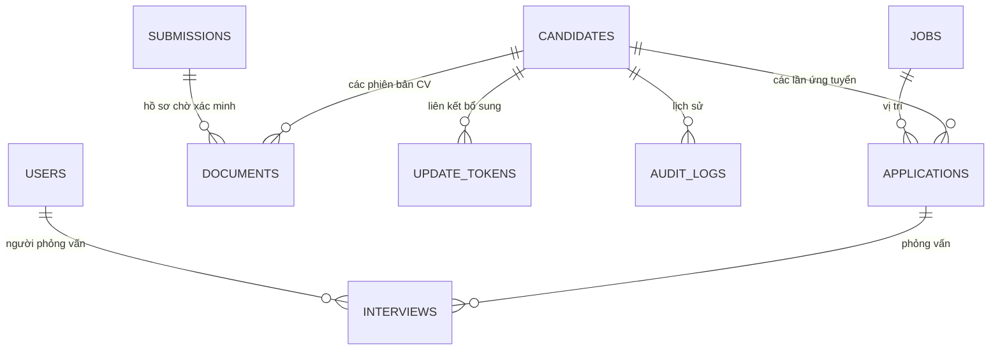

# Thiết kế luồng tiếp nhận thống nhất

Tài liệu này cụ thể hóa yêu cầu hiện tại của Super Net. Hai tài liệu tham khảo mô tả phạm vi dài hạn rộng hơn; implementation tập trung vào tiếp nhận và bổ sung hồ sơ, không giả lập việc AI dịch CV hay Boss đã phê duyệt.

## Mô hình dữ liệu

`candidates` giữ thông tin gốc và nguồn đầu tiên. `applications` giữ nguồn/ngày nhận/giai đoạn của từng lần ứng tuyển. `documents` là bản ghi bất biến về nội dung file; upload mới tạo ID, checksum và phiên bản mới, không ghi đè tệp. `submissions` chứa bản tiếp nhận công khai có dấu hiệu trùng, chưa liên kết vào người nào cho đến khi HR xác nhận.

Mã nguồn schema: `server/db.mjs`. Database có khóa ngoại, index liên hệ, index duy nhất cho lượt đang xử lý và các cập nhật nghiệp vụ trong giao dịch `BEGIN IMMEDIATE`.

## Quy tắc nghiệp vụ đã thực thi

- **Thiếu thông tin:** HR có thể lưu nếu có ít nhất tên, thông tin liên hệ hoặc CV. Tình trạng đầy đủ được suy ra từ tên, liên hệ, ít nhất một lượt ứng tuyển, CV và sự đồng ý; không lưu hai trạng thái có thể lệch nhau.
- **Ngày nhận / ngày nhập:** `received_at` do HR nhập, `created_at` do máy chủ tạo. Không lấy ngày nhập làm ngày nhận thực tế trong trường hợp hồ sơ ngoài hệ thống.
- **Chống trùng:** email chuẩn hóa chữ thường, số điện thoại bỏ dấu phân tách và chuẩn hóa `84` sang `0`. Không dùng tên để tự động hợp nhất. Không có email/phone thì chưa thể phát hiện chắc chắn; HR phải bổ sung/xác minh.
- **Xác nhận khác người:** HR phải nhập lý do. Hệ thống cho phép người khác dùng chung email/phone sau xác minh, không ép unique ở bảng candidate.
- **Cùng người:** HR chọn một gợi ý trùng; thêm ứng tuyển hoặc tài liệu nhưng giữ nguyên thông tin cũ. Chi tiết vừa gửi được lưu trong nhật ký. Tài liệu vẫn cách ly sau khi liên kết.
- **Ứng tuyển lại:** cùng vị trí còn lượt đang xử lý thì thêm vào lượt đó; khác vị trí hoặc lượt trước đã kết thúc thì tạo application mới trên cùng candidate.
- **Gửi lặp:** các API tiếp nhận, upload, xác minh và bổ sung yêu cầu `Idempotency-Key`. Cùng key/nội dung trả lại kết quả cũ; key đã dùng với nội dung khác trả 409. Thay đổi DB và lưu kết quả idempotency nằm cùng giao dịch. Mạng chậm không tạo thêm hồ sơ, application hoặc phiên bản file.
- **Thông tin công khai:** phản hồi tiếp nhận không nói ứng viên đã tồn tại hay chưa; không trả ID, email/phone đã có hoặc gợi ý trùng ra cổng ứng tuyển.
- **Link bổ sung:** ngẫu nhiên 256 bit, chỉ lưu hash, tối đa 7 ngày, một lần dùng, có thể thu hồi. Link chỉ cho thêm dữ liệu vào đúng candidate. Thông tin khác với dữ liệu cũ được giữ trong nhật ký chờ HR xem, không âm thầm sửa danh tính. Replay cùng key sau thành công vẫn trả thành công; gửi mới bằng token đã dùng trả 410.
- **Consent:** biểu mẫu công khai cần checkbox đồng ý; HR đánh dấu đã đồng ý phải nhập căn cứ. Phiên bản/thời điểm/người ghi nhận vào audit. Khi rút lại, các link còn hiệu lực bị thu hồi, và không thể xếp lịch khi thiếu sự đồng ý.
- **Lịch:** kiểm tra start/end hợp lệ, tương lai, người phỏng vấn tồn tại, thông tin liên hệ và consent; truy vấn overlap trong giao dịch để không tạo hai lịch chồng giờ. Không tạo lịch cho lượt đã kết thúc hoặc đã có quyết định. Một người phỏng vấn mỗi lịch trong phạm vi hiện tại.
- **Phê duyệt:** chưa có workflow Boss phê duyệt nên API chặn chuyển sang offer/hired. Không coi điểm hay việc chuyển pipeline là quyết định tuyển dụng.

## API chính

| Nhóm | API |
| --- | --- |
| Xác thực | `POST /api/v1/login`, `GET /api/v1/me`, `POST /api/v1/logout` |
| Demo | `POST /api/v1/demo-session` — chỉ khi `DEMO_MODE=1` |
| Hồ sơ | `GET/POST /api/v1/candidates`, `GET/PATCH /api/v1/candidates/:id` |
| Tài liệu | `POST /api/v1/candidates/:id/documents`, `POST /api/v1/documents/:id/review`, `GET /api/v1/documents/:id/download` |
| Ứng tuyển | `POST /api/v1/candidates/:id/applications`, `PATCH /api/v1/applications/:id` |
| Xác minh trùng | `GET /api/v1/submissions`, `POST /api/v1/submissions/:id/resolve` |
| Link bổ sung | `POST /api/v1/candidates/:id/update-links`, `DELETE /api/v1/candidates/:id/update-links/:hash` |
| Công khai | `GET /api/v1/public/jobs`, `POST /api/v1/public/applications` |
| Bổ sung công khai | `GET/POST /api/v1/public/update-links/:token` |
| Vị trí | `GET/POST /api/v1/jobs`, `PATCH /api/v1/jobs/:id` |
| Lịch | `GET/POST /api/v1/interviews`, `PATCH /api/v1/interviews/:id` |

Form upload dùng `multipart/form-data`, một trường file tên `file`, PDF/DOCX tối đa 10 MB. Những API ghi nội bộ cần cookie phiên cùng `X-Requested-With: SuperNet`. API công khai không yêu cầu đăng nhập. Payload kiểm tra bằng Zod; SQL dùng tham số; tên tệp không được dùng làm đường dẫn lưu.

## Chuyển sang kiến trúc dài hạn

Giữ mô hình candidate/application/document khi chuyển sang PostgreSQL và private object storage. Sau đó bổ sung AV worker/quarantine tự động, outbox cho thông báo, đánh giá độc lập theo người phỏng vấn, phê duyệt Boss có lý do và quyền theo resource. Chỉ nối AI OCR/dịch sau khi có chính sách dữ liệu, provider và kiểm thử chất lượng; luôn lưu extraction/translation tách khỏi CV gốc và yêu cầu HR kiểm tra.

Việc xóa theo yêu cầu cá nhân phải xử lý cả file, nội dung nhập, submissions, audit chứa PII, idempotency response, bản dịch và backup theo chính sách hợp lệ. Phiên bản hiện tại chưa có quy trình xóa/retention hoàn chỉnh và chưa tuyên bố tuân thủ pháp luật cho vận hành thật.
