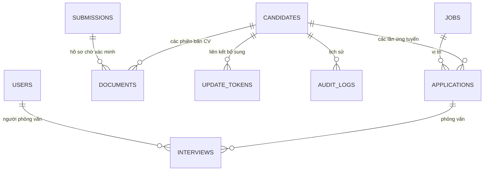

# Thiết kế luồng tiếp nhận thống nhất

Tài liệu này cụ thể hóa yêu cầu hiện tại của Super Net. Phạm vi gồm tiếp nhận/bổ sung hồ sơ, JD, vận hành phỏng vấn, trình xem CV, giao diện Việt–Trung và tích hợp OpenAI dịch CV/JD theo thao tác của nhân sự. Dịch thật cần khóa API; hệ thống không tự quyết định tuyển dụng.

## Bổ sung vận hành nội bộ

`users` có tên đăng nhập duy nhất không phân biệt hoa/thường, trạng thái hoạt động, vai trò Admin/Sếp/HR/Người phỏng vấn (`interviewer`); mật khẩu băm scrypt. Nâng cấp CHECK của SQLite bằng giao dịch dựng lại bảng, giữ ID, hash, phiên, khóa ngoại và chủ sở hữu hồ sơ; kiểm tra referential integrity rồi bật lại foreign keys. Admin được khởi tạo một lần qua `npm run setup`, không có mật khẩu hardcode. Admin tạo/sửa/khóa/đặt lại mật khẩu user qua giao diện, đổi quyền hoặc mật khẩu sẽ thu hồi phiên cũ. Chỉ Admin thấy bảng chức năng/vai trò và danh sách tài khoản; người khác dùng trang tài khoản cá nhân. Dữ liệu nội bộ ở `.data/internal/`, độc lập với demo `.data/`.

`interview_requests` liên kết lượt ứng tuyển, đúng phiên bản CV của ứng viên, người lựa chọn, người phỏng vấn đề xuất, ghi chú, giai đoạn trước đó và trạng thái chờ/đã lên lịch/đã hủy. Sếp, Người phỏng vấn hoặc Admin tạo yêu cầu bằng API riêng; HR không được tự chuyển giai đoạn sang Hẹn phỏng vấn. CV đang chờ kiểm tra vẫn được xem qua trình xem và gắn vào yêu cầu, không tự đổi trạng thái kiểm tra. Người đề xuất phải đang hoạt động và có vai trò Người phỏng vấn/Sếp/Admin. Yêu cầu có idempotency và duy nhất một yêu cầu chờ cho mỗi application. Đây là lựa chọn ứng viên cho vòng phỏng vấn, không phải duyệt offer hay tuyển dụng cuối cùng. Người phỏng vấn chỉ được hủy yêu cầu do mình tạo.

HR nhận yêu cầu qua dashboard và danh sách tự cập nhật 30 giây. `interviews.request_id` gắn lịch với yêu cầu; tạo lịch và đánh dấu yêu cầu đã xử lý cùng một giao dịch. Giờ bắt đầu + thời lượng 15–240 phút tạo giờ kết thúc, lưu UTC chuẩn; bảng dashboard theo ngày hiển thị UTC+7. Kiểm tra overlap của người phỏng vấn lẫn ứng viên qua mọi lượt ứng tuyển. Đổi lịch có lý do và audit before/after; hủy lịch mở lại yêu cầu cũ để HR xếp lại. Không được hoàn thành lịch trước giờ bắt đầu hoặc thay giai đoạn thủ công khi còn lịch hoạt động.

API bổ sung: `GET/POST /api/v1/admin/users`, `PATCH /api/v1/admin/users/:id`, `POST /api/v1/me/password`, `GET /api/v1/interview-requests`, `POST /api/v1/applications/:id/interview-requests`, `PATCH /api/v1/interview-requests/:id`. `POST/PATCH /api/v1/interviews` hỗ trợ thời lượng và đổi lịch. API xem CV cần phiên nhân sự, ghi nhật ký xem; PDF đọc bởi canvas, DOCX lấy nội dung bằng API text riêng.

## Mô hình dữ liệu

`candidates` giữ thông tin gốc và nguồn đầu tiên. `applications` giữ nguồn/ngày nhận/giai đoạn của từng lần ứng tuyển. `documents` là bản ghi bất biến về nội dung file; upload mới tạo ID, checksum và phiên bản mới, không ghi đè tệp. `submissions` chứa bản tiếp nhận công khai có dấu hiệu trùng, chưa liên kết vào người nào cho đến khi HR xác nhận.

Mã nguồn schema: `server/db.mjs`. Database có khóa ngoại, index liên hệ, index duy nhất cho lượt đang xử lý và các cập nhật nghiệp vụ trong giao dịch `BEGIN IMMEDIATE`.

## JD và cổng tuyển dụng

`jobs` bổ sung `requirements`, `benefits`, `working_hours`, `salary_range`, `business_line`, `application_deadline`, `updated_at`, `revision` bằng migration thêm cột, không thay ID hay xóa nội dung cũ. `business_line` nhận `safestraps`, `jielien`, `baby-tatto` hoặc chuỗi rỗng cho tuyển dụng chung. Trang công khai giới thiệu ba ngành hàng; mỗi vị trí có trang JD riêng `/tuyen-dung/:id`, tách khỏi biểu mẫu `/ung-tuyen/:id`.

Các cột `company_name`, `application_instructions`, `application_email`, `application_email_subject`, `application_zalo` lưu đầy đủ tên công ty/cách ứng tuyển. Biểu mẫu `src/job-editor.tsx` giữ trạng thái khi chuyển Nhập thông tin/Xem trước; mẫu `src/jd-template.ts` chép nội dung tài liệu do Super Net cung cấp, chỉ điền khi người dùng chọn và chỉ ghi DB khi lưu. `JDContent` dùng chung cho xem trước và trang công khai, hiển thị thông tin chung, mô tả, yêu cầu, lương/quyền lợi và liên hệ. Văn bản được React escape, dòng bullet thành danh sách; email/Zalo được kiểm tra trước khi lưu.

`server/jobs.mjs` quản lý API JD. GET nội bộ cần phiên đăng nhập; POST/PATCH cần Admin/HR. PATCH kiểm tra dữ liệu sau khi hợp nhất với bản hiện tại để không xóa các trường bị bỏ qua, không đổi ID liên kết application. Giao diện gửi `expectedRevision`; bản cũ bị trả 409. Các cập nhật và audit người sửa/nội dung trước-sau nằm cùng giao dịch.

GET công khai chỉ trả danh sách trường JD cho phép, không trả user, CV, lượt ứng tuyển hay thông tin ứng viên. Tin phải có `status=open` và không có hạn hoặc hạn từ ngày hiện tại tại UTC+7 trở đi. Danh sách, trang JD trực tiếp và API tiếp nhận ứng tuyển dùng chung điều kiện; tin đã đóng/hết hạn không nhận lượt mới, vẫn giữ application/lịch đã có. Nội dung JD là văn bản do React escape, giữ xuống dòng, không render HTML người dùng nhập.

## Quy tắc nghiệp vụ đã thực thi

- **Thiếu thông tin:** HR có thể lưu nếu có ít nhất tên, thông tin liên hệ hoặc CV. Tình trạng đầy đủ được suy ra từ tên, liên hệ, ít nhất một lượt ứng tuyển, CV và sự đồng ý; không lưu hai trạng thái có thể lệch nhau.
- **Ngày nhận / ngày nhập:** `received_at` do HR nhập, `created_at` do máy chủ tạo. Không lấy ngày nhập làm ngày nhận thực tế trong trường hợp hồ sơ ngoài hệ thống.
- **Chống trùng:** email chuẩn hóa chữ thường, số điện thoại bỏ dấu phân tách và chuẩn hóa `84` sang `0`. Không dùng tên để tự động hợp nhất. Không có email/phone thì chưa thể phát hiện chắc chắn; HR phải bổ sung/xác minh.
- **Xác nhận khác người:** HR phải nhập lý do. Hệ thống cho phép người khác dùng chung email/phone sau xác minh, không ép unique ở bảng candidate.
- **Cùng người:** HR chọn một gợi ý trùng; thêm ứng tuyển hoặc tài liệu nhưng giữ nguyên thông tin cũ. Chi tiết vừa gửi được lưu trong nhật ký. Tài liệu vẫn cách ly sau khi liên kết.
- **Ứng tuyển lại:** cùng vị trí còn lượt đang xử lý thì thêm vào lượt đó; khác vị trí hoặc lượt trước đã kết thúc thì tạo application mới trên cùng candidate.
- **Gửi lặp:** các API tiếp nhận, upload, xác minh và bổ sung yêu cầu `Idempotency-Key`. Cùng key/nội dung trả lại kết quả cũ; key đã dùng với nội dung khác trả 409. Thay đổi DB và lưu kết quả idempotency nằm cùng giao dịch. Mạng chậm không tạo thêm hồ sơ, application hoặc phiên bản file.
- **Thông tin công khai:** phản hồi tiếp nhận không nói ứng viên đã tồn tại hay chưa; không trả ID, email/phone đã có hoặc gợi ý trùng ra cổng ứng tuyển.
- **Link bổ sung:** ngẫu nhiên 256 bit, chỉ lưu hash, tối đa 7 ngày, một lần dùng, có thể thu hồi. Link chỉ cho thêm dữ liệu vào đúng candidate. Thông tin khác với dữ liệu cũ được giữ trong nhật ký chờ HR xem, không âm thầm sửa danh tính. Replay cùng key sau thành công vẫn trả thành công; gửi mới bằng token đã dùng trả 410.
- **Consent và trao đổi lịch:** biểu mẫu công khai cần checkbox đồng ý; HR đánh dấu đã đồng ý phải nhập căn cứ. Khi trạng thái `pending`, HR/Admin vẫn có thể xếp lịch nếu có thông tin liên hệ và gửi `contactConfirmed=true` cùng `contactEvidence` từ 10 ký tự. Lưu `interviews.contact_evidence/contacted_at/contacted_by` và audit riêng; không tự sửa `candidates.consent_status/consent_at`. Khi đổi lịch, ghi nhận cũ được giữ nếu không có nội dung trao đổi mới. `withdrawn` vẫn chặn xếp/đổi lịch, thu hồi link; muốn tiếp tục cần ghi nhận sự đồng ý mới thực tế.
- **Tiếp nhận tệp:** mọi định dạng, tối đa 10 MB, giữ bytes/checksum gốc; quét mã độc trước khi lưu. Microsoft Defender trên Windows hoặc ClamAV, lỗi bộ quét hoặc phát hiện nguy hiểm không lưu tệp. Kết quả quét gắn với checksum và phiên bản; CV cũ không tự gắn nhãn đã quét. Xem [cấu hình bộ quét](antivirus.md).
- **Xem/tải:** staff có thể đọc/tải tài liệu của ứng viên và hồ sơ đang chờ xác minh. Kiểm tra thủ công giữ riêng, không chặn tải. PDF hiển thị bằng PDF.js canvas, tối đa 50 trang/16 MP mỗi trang; DOCX trích xuất văn bản cục bộ trong worker có giới hạn bộ nhớ/thời gian/giải nén. Không render HTML từ CV, không thực thi mã hoặc liên kết ngoài. Ảnh/TXT xem cục bộ; định dạng khác chỉ tải bản gốc. Tệp gốc và kết quả quét được giữ nguyên.
- **API:** `GET /documents/:id/preview` và `/download` giữ bytes, hỗ trợ tên Unicode và byte ranges, cần đăng nhập. `GET /documents/:id/text` đọc nội dung PDF/DOCX cục bộ; không mở công khai và không gửi ra ngoài.

## Xem CV và dịch Việt–Trung

`server/app.mjs` phục vụ bytes gốc có kiểm tra phiên và ghi nhật ký. Frontend PDF.js vẽ canvas thay cho plugin/iframe, không thực thi action/script PDF. `server/documents.mjs` cung cấp API trích xuất văn bản cục bộ cho PDF/DOCX; `review_status` giữ metadata kiểm tra thủ công riêng, không chặn xem/tải. Dữ liệu không được truy cập công khai.

`document-worker.mjs` dùng unpdf để trích văn bản PDF; DOCX chỉ giải nén document/header/footer XML, không nạp liên kết/ảnh bên ngoài. DTD/entity tùy biến bị từ chối. Văn bản hiển thị bằng React escape. Worker riêng có giới hạn bộ nhớ/thời gian, tối đa 50 trang, 60.000 ký tự, XML giải nén 5 MB. PDF scan vẫn xem được và có thể dùng input_file để dịch/OCR khi model hỗ trợ.

`src/locale.tsx` lưu `vi`/`zh-CN` trong localStorage, thay nhãn thông qua bộ từ điển `zh-CN.ts`. Giá trị option/form, mã vai trò, dữ liệu ứng viên và nguồn JD được giữ nguyên; ngày/giờ hiển thị theo locale nhưng timezone UTC+7 cố định. Font Trung và tài nguyên PDF tự phục vụ từ website.

`translations.mjs` dùng OpenAI Responses API qua máy chủ với store:false, JSON schema, timeout 60 giây và giới hạn 10 yêu cầu/phút/nhân sự. Khóa đọc từ biến môi trường hoặc `.env.translation`, không trả ra API/client/log. Chỉ thao tác dịch mới gọi dịch vụ ngoài; UI song ngữ/xem CV thực hiện cục bộ. Prompt yêu cầu coi nội dung là dữ liệu, dịch đầy đủ, không thực hiện chỉ dẫn trong CV và không đánh giá/xếp hạng ứng viên. Lỗi provider được thông báo bằng nội dung do ứng dụng kiểm soát, không trả body chứa dữ liệu/khóa.

`translation-settings.mjs` lưu cấu hình do Admin nhập trong `DATA_DIR/translation-settings.json`, mã hóa khóa bằng AES-256-GCM với master key riêng tại `DATA_DIR/.translation-master-key`; quyền tệp 0600, ghi thay thế nguyên tử. GET chỉ trả model, trạng thái, revision, ngày cập nhật/nhắc và kết quả kiểm tra. PUT dùng revision tránh ghi đè cấu hình mới; ô khóa trống giữ khóa hiện tại. `reminderDays=30` là lịch nhắc, không phải hạn hiệu lực cưỡng chế. Mỗi lần dịch lấy snapshot cấu hình hiện tại để thay khóa có hiệu lực ngay và audit đúng model đã dùng. Kiểm tra API chỉ gửi câu mẫu, không gửi CV, không ghi trạng thái thành công cho khóa đã thay trong lúc chờ provider.

Khóa Admin ưu tiên hơn `SUPERNET_TRANSLATION_API_KEY`/`OPENAI_API_KEY` và `.env.translation`. Cấu hình kế thừa từ môi trường không chép placeholder proxy vào tệp. API quản lý khóa chỉ dành cho Admin trong chế độ nội bộ; demo không dùng khóa thật. Vite từ chối `.data/**` để không phục vụ SQLite, ciphertext hoặc master key qua HTTP. Sao lưu cần giữ cả thư mục dữ liệu riêng.

`document_translations` khóa theo document_id + target_language + source_checksum. `job_translations` khóa theo job_id + target_language + source_revision. Bản dịch và audit lưu cùng giao dịch; gộp yêu cầu đồng thời, dùng cache cho lần mở sau. Kiểm tra lại revision/consent sau khi provider trả kết quả; không lưu bản dịch lỗi hoặc stale, không tự thay đổi consent hay tệp gốc. Người đã rút lại đồng ý không được gửi CV tới provider. POST dịch JD cần Admin/HR; GET công khai chỉ ghép bản dịch khớp revision với tin đang mở/còn hạn và giữ ID, email, Zalo của bản gốc.

Các mục trống trong JD gốc được giữ trống ở bản dịch, kể cả khi provider trả thêm nội dung; không tự tạo mức lương, quyền lợi hoặc giờ làm. Mục có nội dung gốc mà bản dịch để trống bị coi là kết quả chưa đầy đủ.

## API chính

| Nhóm | API |
| --- | --- |
| Xác thực | `POST /api/v1/login`, `GET /api/v1/me`, `POST /api/v1/logout` |
| Demo | `POST /api/v1/demo-session` — chỉ khi `DEMO_MODE=1` |
| Hồ sơ | `GET/POST /api/v1/candidates`, `GET/PATCH /api/v1/candidates/:id` |
| Tài liệu | `POST /api/v1/candidates/:id/documents`, `POST /api/v1/documents/:id/review`, `GET /api/v1/documents/:id/download` |
| Ứng tuyển | `POST /api/v1/candidates/:id/applications`, `PATCH /api/v1/applications/:id` |
| Xác minh trùng | `GET /api/v1/submissions`, `POST /api/v1/submissions/:id/resolve` |
| Link bổ sung | `POST /api/v1/candidates/:id/update-links`, `DELETE /api/v1/candidates/:id/update-links/:hash` |
| Công khai | `GET /api/v1/public/jobs`, `GET /api/v1/public/jobs/:id`, `POST /api/v1/public/applications` |
| Bổ sung công khai | `GET/POST /api/v1/public/update-links/:token` |
| Vị trí | `GET/POST /api/v1/jobs`, `PATCH /api/v1/jobs/:id` |
| Xem CV | `GET /api/v1/documents/:id/preview`, `GET /api/v1/documents/:id/text` |
| Dịch CV | `POST /api/v1/documents/:id/translations`, `GET /api/v1/documents/:id/translations/:language` |
| Dịch JD | `POST /api/v1/jobs/:id/translations`, `GET /api/v1/jobs/:id/translations/:language` |
| Cấu hình dịch | `GET /api/v1/translation/status` — chỉ trả trạng thái/model, không trả khóa |
| Quản lý khóa dịch | `GET/PUT /api/v1/admin/translation-settings`, `POST /api/v1/admin/translation-settings/test` — chỉ Admin |
| Lịch | `GET/POST /api/v1/interviews`, `PATCH /api/v1/interviews/:id` |

Form upload dùng `multipart/form-data`, một trường file tên `file`, mọi định dạng tối đa 10 MB và được quét trước khi lưu. Những API ghi nội bộ cần cookie phiên cùng `X-Requested-With: SuperNet`. API công khai không yêu cầu đăng nhập. Payload kiểm tra bằng Zod; SQL dùng tham số; tên tệp không được dùng làm đường dẫn lưu.

## Chuyển sang kiến trúc dài hạn

Giữ mô hình candidate/application/document khi chuyển sang PostgreSQL và private object storage. Sau đó bổ sung AV worker/quarantine tự động, outbox cho thông báo, đánh giá độc lập theo người phỏng vấn, phê duyệt Boss có lý do và quyền theo resource. Tích hợp dịch đã chuẩn bị với OpenAI; trước vận hành cần cấu hình khóa/model và kiểm tra chất lượng trên dữ liệu phù hợp. Bản dịch tách khỏi CV gốc và dùng để tham khảo khi nhân sự đọc hồ sơ.

Việc xóa theo yêu cầu cá nhân phải xử lý cả file, nội dung nhập, submissions, audit chứa PII, idempotency response, bản dịch và backup theo chính sách hợp lệ. Phiên bản hiện tại chưa có quy trình xóa/retention hoàn chỉnh và chưa tuyên bố tuân thủ pháp luật cho vận hành thật.

## Bảo vệ cập nhật và khôi phục giao dịch

Hồ sơ có cột `revision`, mặc định 1 khi nâng cấp database. `PATCH /candidates/:id` cần `expectedRevision`; kiểm tra sau `BEGIN IMMEDIATE`, rồi cập nhật các trường, consent, audit và tăng revision trong cùng giao dịch. Bản cũ nhận 409, thiếu phiên bản nhận 428. Bổ sung dữ liệu/CV và xác minh trùng cũng tăng revision; giao diện chỉnh sửa và phân công HR gửi đúng snapshot đã đọc. Không tự tải revision mới rồi thử lại bản nháp cũ.

`POST /jobs` dùng `Idempotency-Key` theo người tạo, giữ cả tạo JD, audit và kết quả gửi lại trong cùng giao dịch. Gửi lại cùng mã/nội dung trả lại 201 với cùng ID; nội dung khác bị trả 409. Giao diện giữ mã khi mất phản hồi và thay mã khi đổi nội dung.

Giao dịch tiếp nhận giữ nhật ký riêng các tệp vừa được tạo bằng `open(...,'wx')`. Lỗi ghi, audit hoặc ghi kết quả chống gửi lặp đều rollback database và dọn đúng các tệp mới; không xóa tệp có sẵn. Tệp chỉ được ghi sau khi quét đạt. Luồng xác minh chỉ cho xử lý JD đã đóng/hết hạn từ submission đã được tiếp nhận; không mở lại đăng tuyển hoặc nhận lượt gửi mới.

Xem [đối chiếu QA ngày 31/10/2026](qa-fixes-2026-10-31.md) để biết các ca kiểm thử và công việc còn lại.
